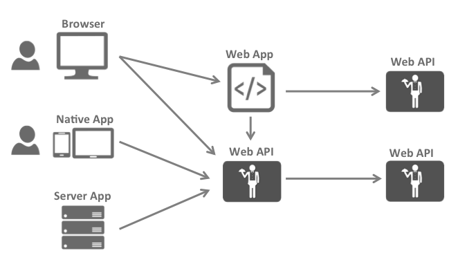
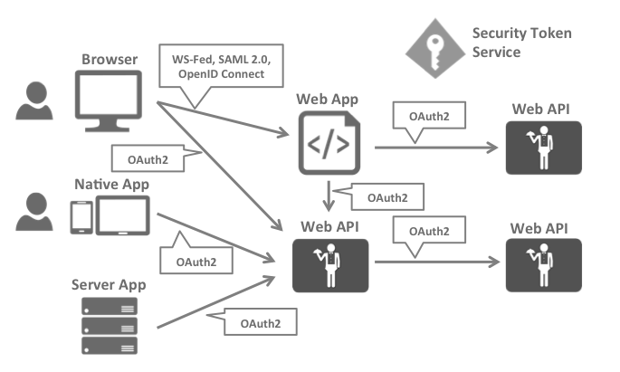
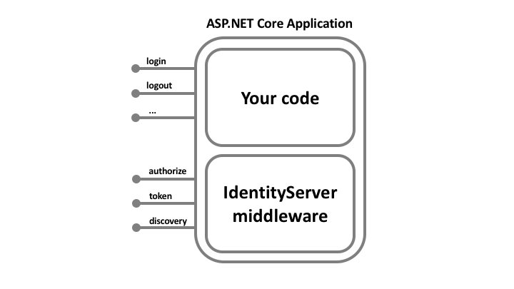

[[go back to index]](../index.md#documentation-structure)

# The Big Picture

Most modern applications look more or less like this:

The most common interactions are:

* Browsers communicate with web applications
* Web applications communicate with web APIs (sometimes on their own, sometimes on behalf of a user)
* Browser-based applications communicate with web APIs
* Native applications communicate with web APIs
* Server-based applications communicate with web APIs
* Web APIs communicate with web APIs (sometimes on their own, sometimes on behalf of a user)

Each layer (front end, middle tier and back end) has to protect resources and implement authentication and
authorization, often against the same user store.

Moving these functions to a security token service avoids repeating them in every application and API. The
architecture then looks like this:

This design divides security into two concerns.

## Authentication

An application needs authentication when it needs to know who the current user is. It usually manages data on behalf
of that user and must make sure the user only reaches the data they are allowed to. Classic web applications are the
most common example, but native and browser-based applications need it too.

The common authentication protocols are SAML2p, WS-Federation and OpenID Connect. OpenID Connect is the newest. It
was designed for mobile and API scenarios from the start, and it is the one MinApiLib.Oidc implements.

## API Access

Applications call APIs in two ways: with their own identity, or on behalf of a user. Sometimes they combine both.

OAuth 2.0 lets applications request access tokens from a security token service and use them to call APIs.
Authentication and authorization are centralized, which keeps both the clients and the APIs simpler.

## OpenID Connect and OAuth 2.0 together

OpenID Connect is an extension of OAuth 2.0. Together they cover both concerns, authentication and API access, in a
single protocol, often with a single round trip to the security token service.

Access tokens are bearer tokens by default: whoever holds one can use it. Proof of possession binds a token to a key
the client holds, so a stolen token is useless on its own. MinApiLib.Oidc supports it with DPoP (RFC 9449) from the
server to the clients and the APIs, and with mutual TLS on the server. See
[Proof-of-Possession Access Tokens](../topics/pop.md).

## How MinApiLib.Oidc can help

`MinApiLib.Oidc.Server` adds the OpenID Connect and OAuth 2.0 endpoints to an ASP.NET Core application.

You build (or reuse) an application with a login page and a logout page, and a consent page if your clients need it.
The server adds the protocol endpoints, so client applications can talk to it with the standard protocols. There is
no ready-made UI: the [samples](../../samples/README.md) show minimal login, logout and error pages.

The host can be as complex as you want, but keep the attack surface small: include the authentication UI only.

The other packages cover the other side of the picture. `MinApiLib.Oidc.Http` and `MinApiLib.Oidc.Authentication`
get, cache, refresh and send access tokens from client applications, and `MinApiLib.Oidc.JwtBearer` adds DPoP to
ASP.NET Core JWT bearer authentication in APIs. They work with any OpenID Connect server. See
[Packages and Builds](packaging.md).

[[go back to index]](../index.md#documentation-structure)
