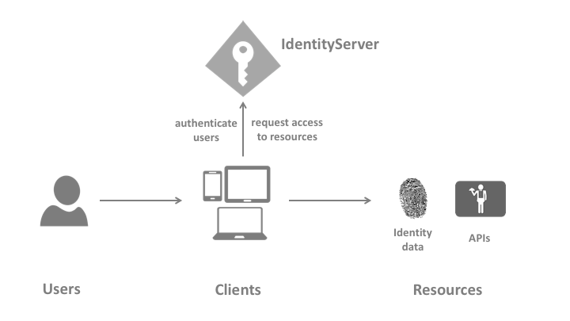

[[go back to index]](../index.md#documentation-structure)

# Terminology

The specs, this documentation and the object model use the following terms.

## OpenID Connect provider

`MinApiLib.Oidc.Server` is an OpenID Connect provider: it implements the OpenID Connect and OAuth 2.0 protocols.

The literature uses other names for the same role: security token service, identity provider, authorization
server, IP-STS and more. They all mean a piece of software that issues security tokens to clients.

The server's jobs include:

* protect your resources
* authenticate users with a local account store or through an external identity provider
* provide session management and single sign-on
* manage and authenticate clients
* issue identity and access tokens to clients
* validate tokens

The server does not include a user store or a login UI. The host application provides them.

## User

A user is a human who uses a registered client to access resources.

## Client

A client is a piece of software that requests tokens from the server, either to authenticate a user (it requests an
identity token) or to access a resource (it requests an access token). A client must be registered with the server
before it can request tokens.

Examples of clients are web applications, native mobile or desktop applications, SPAs and server processes.

## Resources

Resources are what you protect with the server: identity data of your users, or APIs.

Every resource has a unique name, and clients use this name to say which resources they want to access.

**Identity data**
Identity information (claims) about a user, for example their name or email address. It is modelled as an
`IdentityResource`.

**APIs**
API resources represent functionality a client wants to invoke, usually web APIs. They are modelled as `ApiScope`
(what a client may ask for) and `ApiResource` (the API, which becomes the `aud` of the access token). See
[Defining Resources](../topics/resources.md).

## Identity Token

An identity token represents the outcome of an authentication. It contains at least an identifier for the user (the
`sub`, or subject, claim) and information about how and when the user authenticated. It can contain more identity
data.

## Access Token

An access token allows access to an API resource. Clients request access tokens and forward them to the API. Access
tokens contain information about the client and the user, if there is one. APIs use that information to authorize
access to their data.

An access token is a **bearer** token by default: whoever holds it can use it. A **DPoP-bound** token (RFC 9449)
carries the thumbprint of a key the client holds (`cnf.jkt`), and each request must come with a proof signed by that
key. See [Proof-of-Possession Access Tokens](../topics/pop.md).

[[go back to index]](../index.md#documentation-structure)
