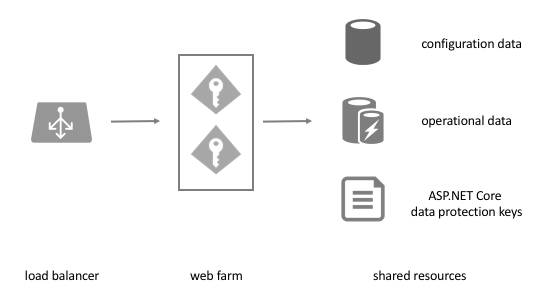

[[go back to index]](../index.md#documentation-structure)

# Deployment

A server built with `MinApiLib.Oidc.Server` is a standard ASP.NET Core application. Read the Microsoft
[documentation](https://learn.microsoft.com/aspnet/core/host-and-deploy/) on hosting and deployment first, especially
the [section](https://learn.microsoft.com/aspnet/core/host-and-deploy/proxy-load-balancer) about proxies and load
balancers: behind a proxy, use the forwarded headers middleware so the server sees the scheme and host the clients
used, or set `OidcServerOptions.IssuerUri`.

## Typical architecture

Typically you will design the deployment for high availability:

The server itself is stateless and needs no server affinity, but some data must be shared between the instances.

## Configuration data

This typically includes:

* resources;
* clients;
* startup configuration, for example key material and external provider settings.

Where you keep it depends on your environment. When configuration rarely changes, use the in-memory stores, with
code or configuration files. `AddOidcServer` accepts a configuration section for `OidcServerOptions`, and the
`AddInMemory*` methods accept sections for clients and resources (see
[configuration](https://learn.microsoft.com/aspnet/core/fundamentals/configuration/)).

In dynamic environments, load the configuration from a database. `MinApiLib.Oidc.Server.MongoDB` stores clients,
resources and CORS origins in MongoDB (see [Startup](startup.md#refstartup)). You can also build your own stores by
implementing `IClientStore`, `IResourceStore` and `ICorsPolicyService`, and cache them with `AddClientStoreCache`,
`AddResourceStoreCache` and `AddCorsPolicyCache`.

## Key material

The signing keys are part of the startup configuration, or are created and rotated by automatic key management, in
a key store every instance shares. See [Cryptography, Keys and HTTPS](crypto.md#refcrypto).

## Operational data

For some operations the server needs a store to keep state:

* authorization codes;
* reference and refresh tokens;
* consents;
* pushed authorization requests and authorization nonces;
* device codes of the device flow.

By default these live in memory: they are lost on restart and not shared between instances. The server logs a
warning when it runs with the in-memory grant store outside the Development environment. Use
`MinApiLib.Oidc.Server.MongoDB`, which also expires old entries with TTL indexes, or implement `IPersistedGrantStore`
and `IDeviceFlowStore`. See [Persisted Grants](persisted_grants.md#refpersistedgrants).

## ASP.NET Core data protection

ASP.NET Core needs shared key material to protect cookies, state strings and similar data. The server also uses it,
for example for the private keys of automatic key management. See the
[data protection documentation](https://learn.microsoft.com/aspnet/core/security/data-protection/introduction).

## ASP.NET Core distributed caching

Some components use `IDistributedCache`. `AddOidcServer` registers the in-memory implementation, which is not shared
between instances; with several instances, register a distributed one (see the
[documentation](https://learn.microsoft.com/aspnet/core/performance/caching/distributed)).

These components use `IDistributedCache`:

* `DefaultReplayCache` (`IReplayCache`), which remembers the DPoP proofs and client assertions already used, so each
  is accepted once;
* `DistributedDeviceFlowThrottlingService`, which throttles device flow polling, and the device flow interaction
  service, which counts failed user code attempts;
* `DistributedCacheAuthorizationParametersMessageStore`, if you register it with
  `AddAuthorizationParametersMessageStore<T>`;
* `services.AddOidcStateDataFormatterCache()`, which makes the OpenID Connect handlers of the application keep the
  `state` parameter in the cache instead of the URL.

[[go back to index]](../index.md#documentation-structure)
