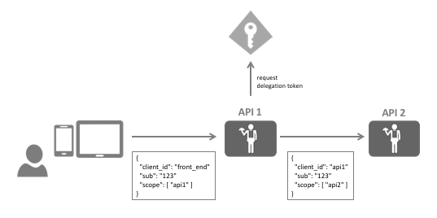

[[go back to index]](../index.md#documentation-structure)

<a id="refextensiongrants"></a>

# Extension Grants

OAuth 2.0 defines standard grant types for the token endpoint, such as `password`, `authorization_code` and `refresh_token`. Extension grants are a way to add support for non-standard token issuance scenarios like token translation, delegation, or custom credentials.

You can add support for additional grant types by implementing the `IExtensionGrantValidator` interface (namespace
`MinApiLib.Oidc.Server.Features.Tokens.Grants`):

```csharp
public interface IExtensionGrantValidator
{
    /// <summary>
    /// Handles the custom grant request.
    /// </summary>
    /// <param name="context">The validation context.</param>
    Task ValidateAsync(ExtensionGrantValidationContext context);

    /// <summary>
    /// Returns the grant type this validator can deal with
    /// </summary>
    /// <value>
    /// The type of the grant.
    /// </value>
    string GrantType { get; }
}
```

The `ExtensionGrantValidationContext` object gives you access to:

* the incoming token request - both the well-known validated values, as well as any custom values (via the `Raw` collection)
* the result (`GrantValidationResult`) - either error or success, optionally with custom response parameters

To register the extension grant, add it with the builder:

```csharp
builder.Services.AddOidcServer()
    .AddExtensionGrantValidator<MyExtensionGrantValidator>();
```

Discovery lists the extension grant types in `grant_types_supported` (`DiscoveryOptions.ShowExtensionGrantTypes`).

## Example: Simple delegation using an extension grant

Imagine the following scenario - a front end client calls a middle tier API using a token acquired via an interactive flow (e.g. the authorization code flow).
This middle tier API (API 1) now wants to call a back end API (API 2) on behalf of the interactive user:



In other words, the middle tier API (API 1) needs an access token containing the user’s identity, but with the scope of the back end API (API 2).

#### NOTE
You might have heard of the term *poor man’s delegation* where the access token from the front end is simply forwarded to the back end. This has some shortcomings, e.g. *API 2* must now accept the *API 1* scope which would allow the user to call *API 2* directly. Also - you might want to add some delegation specific claims into the token, e.g. the fact that the call path is via *API 1*.

**Implementing the extension grant**

The front end would send the token to API 1, and now this token needs to be exchanged at the server for a new token for API 2.

On the wire the call to the token endpoint for the exchange could look like this:

```http
POST /connect/token HTTP/1.1
Host: login.example.com
Content-Type: application/x-www-form-urlencoded

grant_type=delegation&scope=api2&token=eyJhbGciOiJSUzI1NiIs...&client_id=api1.client&client_secret=secret
```

It’s the job of the extension grant validator to handle that request by validating the incoming token, and returning a result that represents the new token:

```csharp
public class DelegationGrantValidator(ITokenValidator validator) : IExtensionGrantValidator
{
    public string GrantType => "delegation";

    public async Task ValidateAsync(ExtensionGrantValidationContext context)
    {
        var userToken = context.Request.Raw.Get("token");
        if (string.IsNullOrEmpty(userToken))
        {
            context.Result = new GrantValidationResult(TokenRequestErrors.InvalidGrant);
            return;
        }

        var result = await validator.ValidateAccessTokenAsync(userToken);
        if (result.IsError)
        {
            context.Result = new GrantValidationResult(TokenRequestErrors.InvalidGrant);
            return;
        }

        // get the user's identity
        var sub = result.Claims.FirstOrDefault(c => c.Type == "sub")?.Value;
        if (sub is null)
        {
            context.Result = new GrantValidationResult(TokenRequestErrors.InvalidGrant);
            return;
        }

        context.Result = new GrantValidationResult(sub, GrantType);
    }
}
```

`ITokenValidator` lives in `MinApiLib.Oidc.Server.Core.TokenServices`, and `GrantValidationResult` and
`TokenRequestErrors` in `MinApiLib.Oidc.Server.Features.Tokens`. Don’t forget to register the validator with
`AddExtensionGrantValidator<DelegationGrantValidator>()`.

**Registering the delegation client**

You need a client registration that allows a client to use this new extension grant, e.g.:

```csharp
var client = new Client
{
    ClientId = "api1.client",
    ClientSecrets = { new Secret("secret".Sha256()) },

    AllowedGrantTypes = { "delegation" },

    AllowedScopes = { "api2" }
};
```

**Calling the token endpoint**

In API 1 you can now send the request above with `HttpClient`:

```csharp
public async Task<string> DelegateAsync(HttpClient http, string userToken)
{
    var response = await http.PostAsync("https://login.example.com/connect/token", new FormUrlEncodedContent(new Dictionary<string, string>
    {
        ["grant_type"] = "delegation",
        ["scope"] = "api2",
        ["token"] = userToken,
        ["client_id"] = "api1.client",
        ["client_secret"] = "secret"
    }));
    response.EnsureSuccessStatusCode();

    using var json = await JsonDocument.ParseAsync(await response.Content.ReadAsStreamAsync());
    return json.RootElement.GetProperty("access_token").GetString()!;
}
```

The `access_token` of the response is the delegation access token.

[[go back to index]](../index.md#documentation-structure)
