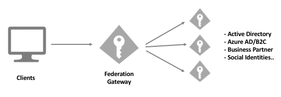

[[go back to index]](../index.md#documentation-structure)

# Federation Gateway

A common architecture is the so-called federation gateway. In this approach the server acts as a gateway to one or
more external identity providers.

This architecture has the following advantages:

* your applications only need to know about the one token service (the gateway) and are shielded from all the details about connecting to the external provider(s). This also means that you can add or change those external providers without needing to update your applications.
* you control the gateway (as opposed to some external service provider) - this means you can make any changes to it and can protect your applications from changes those external providers might do to their own services.
* most external providers only support a fixed set of claims and claim types - having a gateway in the middle allows post-processing the response from the providers to transform/add/amend domain specific identity information.
* some providers don't support access tokens (e.g. social providers) - since the gateway knows about your APIs, it can issue access tokens based on the external identities.
* some providers charge by the number of applications you connect to them. The gateway acts as a single application to the external provider. Internally you can connect as many applications as you want.
* some providers use proprietary protocols or made proprietary modifications to standard protocols - with a gateway there is only one place you need to deal with that.
* forcing every authentication (internal or external) through one single place gives you a lot of flexibility with regards to identity mapping, providing a stable identity to all your applications and dealing with new requirements.

In other words, owning your federation gateway gives you control over your identity infrastructure.

## Implementation

The host's login page does the federation; [external providers](signin_external_providers.md) describes the steps.

* Add an authentication handler to the server host for each external identity provider.
* `IAuthenticationSchemeProvider.GetAllSchemesAsync()` lists the registered handlers, so the login page can show the
  providers it has (handlers with a display name are usually the ones to show).
* `Client.IdentityProviderRestrictions` limits the providers a client may use. The server enforces it: a session from
  another provider sends the user to the login page again. The login page reads the client from
  `IOidcServerInteractionService.GetAuthorizationContextAsync(returnUrl)` and shows only the allowed providers.
* `Client.EnableLocalLogin` tells the login page whether to show the local user name and password form.
* A client can ask for a provider with `acr_values=idp:<scheme>`. The login page finds it in `AuthorizationRequest.IdP`
  and can go straight to that provider.
* Send every external sign-in to a single callback, so the claims of all providers are transformed in one place.

[[go back to index]](../index.md#documentation-structure)
