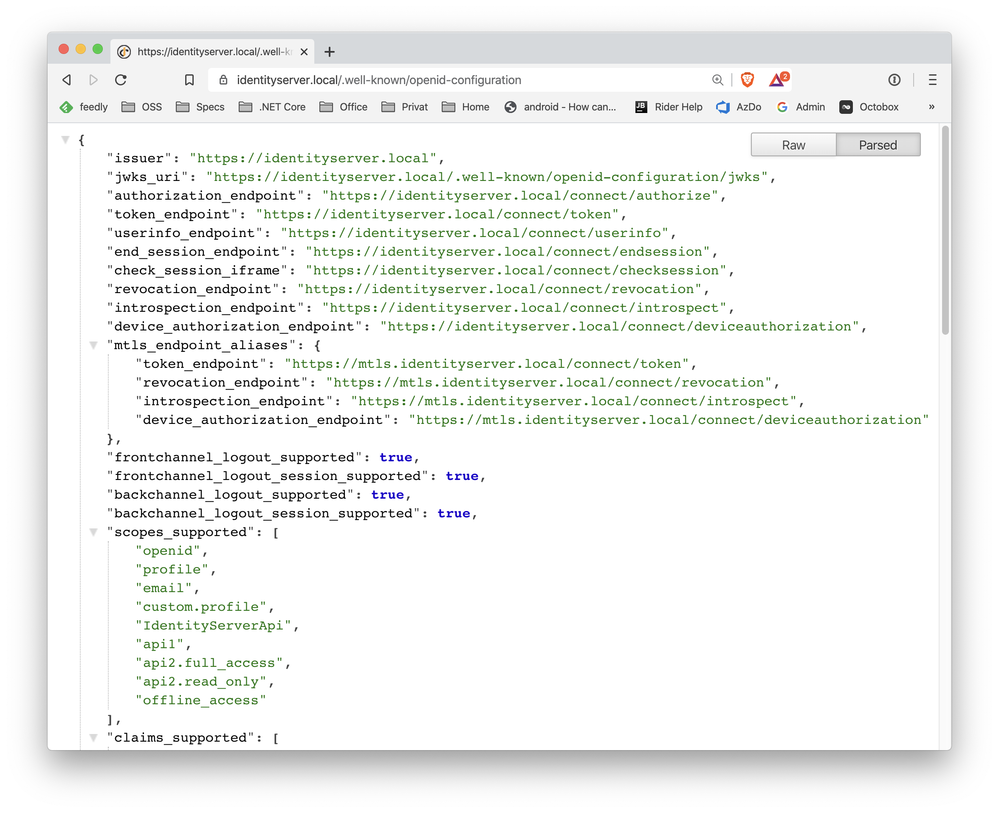
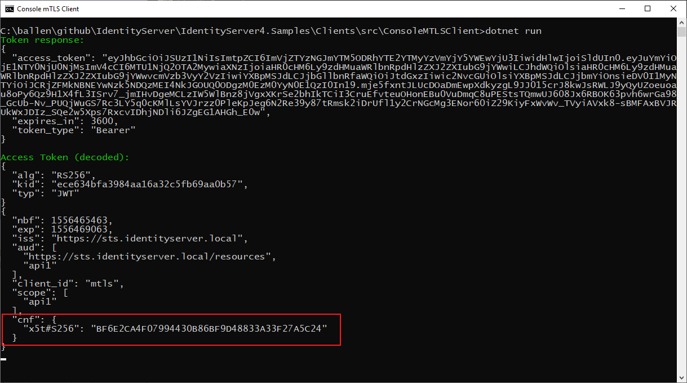

[[go back to index]](../index.md#documentation-structure)

<a id="refmutualtls"></a>

# Mutual TLS

Mutual TLS support in the server provides two features:

* Client authentication to the server's endpoints with a TLS X.509 client certificate
* Binding of access tokens to a TLS X.509 client certificate

#### NOTE
See [RFC 8705, OAuth 2.0 Mutual-TLS Client Authentication and Certificate-Bound Access Tokens](https://www.rfc-editor.org/rfc/rfc8705)
for more information. [DPoP](pop.md#dpop) binds tokens to a key without any TLS configuration, and is usually
simpler to deploy.

Setting up mTLS involves a couple of steps.

## Server setup

It's the hosting layer's responsibility to do the actual validation of the client certificate. The server then uses
that information to associate the certificate with a client and to embed the certificate information in the access
tokens.

The steps differ depending on the web server or proxy in front of the application. With Kestrel facing the clients
directly, ask for the certificate in the HTTPS options. `AllowCertificate` lets clients without a certificate use the
other endpoints:

```csharp
builder.WebHost.ConfigureKestrel(kestrel =>
    kestrel.ConfigureHttpsDefaults(https => https.ClientCertificateMode = ClientCertificateMode.AllowCertificate));
```

#### NOTE
[mkcert](https://github.com/FiloSottile/mkcert) is a third-party utility that creates certificates for development.

## ASP.NET Core setup

Typically a reverse proxy sits in front of the application server and terminates TLS. In addition to the usual
forwarded headers handling, the application then reads the client certificate from a header that the proxy sets.
Add a call to `app.UseCertificateForwarding()` at the beginning of the middleware pipeline, before `UseOidcServer()`.

The way proxies transmit the certificate is not standardized, so you register a callback that parses the header.
Microsoft's [documentation](https://learn.microsoft.com/aspnet/core/security/authentication/certauth) shows how that
works for Azure App Service. Nginx sends the certificate as URL-encoded PEM:

```csharp
builder.Services.AddCertificateForwarding(options =>
{
    // the header name depends on your nginx configuration
    options.CertificateHeader = "X-SSL-CERT";

    options.HeaderConverter = headerValue =>
        string.IsNullOrWhiteSpace(headerValue)
            ? null
            : X509Certificate2.CreateFromPem(Uri.UnescapeDataString(headerValue));
});
```

Once the certificate is loaded, set up the certificate authentication handler. This example accepts self-signed
certificates, hence `CertificateTypes.All` and no revocation checking. These settings might be different in your
environment:

```csharp
builder.Services.AddAuthentication()
    .AddCertificate(options =>
    {
        options.AllowedCertificateTypes = CertificateTypes.All;
        options.RevocationMode = X509RevocationMode.NoCheck;
    });
```

## MinApiLib.Oidc.Server setup

Next, enable mTLS in the server with `OidcServerOptions.MutualTls` (`MutualTlsOptions`). Specify the name of the
certificate authentication handler you set up in the last step (`ClientCertificateAuthenticationScheme`, `Certificate`
by default) and where the mTLS endpoints live (`DomainName`).

The mTLS endpoints can be hosted in three ways, assuming the server runs on `https://login.example.com`:

* path-based (`DomainName` not set): endpoints beneath `/connect/mtls`, e.g. `https://login.example.com/connect/mtls/token`.
  Every `connect/` route has this alias; it answers `404` in the other two modes.
* sub-domain based (`DomainName` without dots, e.g. `mtls`): endpoints on a sub-domain of the main server, e.g.
  `https://mtls.login.example.com/connect/token`.
* domain-based (`DomainName` with dots, e.g. `mtls.example.com`): endpoints on a different domain, e.g.
  `https://mtls.example.com/connect/token`. In this case set a static `IssuerUri`.

For example:

```csharp
builder.Services.AddOidcServer(options =>
    {
        options.MutualTls.Enabled = true;
        options.MutualTls.ClientCertificateAuthenticationScheme = "Certificate";

        // uses sub-domain hosting
        options.MutualTls.DomainName = "mtls";
    })
    .AddMutualTlsSecretValidators();
```

On those endpoints `UseOidcServer()` authenticates the client certificate with that scheme, and answers `403` when
it fails. The discovery document lists the token, revocation, introspection, pushed authorization and device
authorization endpoints in `mtls_endpoint_aliases`:



## Client authentication

Clients can authenticate to the server's endpoints with an X.509 client certificate. For this, associate a client
certificate with a client. `AddMutualTlsSecretValidators()` on the [builder](startup.md) adds the services that do
that, either by thumbprint or by distinguished name, and discovery then announces `tls_client_auth` and
`self_signed_tls_client_auth`.

Then, in the [client configuration](../reference/client.md), add to `ClientSecrets` a secret of type
`OidcServerConstants.SecretTypes.X509CertificateName` to authenticate the client by the certificate's distinguished
name, or `OidcServerConstants.SecretTypes.X509CertificateThumbprint` to authenticate it by the certificate's
thumbprint. For example:

```csharp
new Client
{
    ClientId = "orders.worker",
    AllowedGrantTypes = GrantTypes.ClientCredentials,
    AllowedScopes = { "orders.read" },
    ClientSecrets =
    {
        // name based
        new Secret("CN=orders.worker, O=Example", "orders worker certificate")
        {
            Type = OidcServerConstants.SecretTypes.X509CertificateName
        },
        // or thumbprint based
        //new Secret("bca0d040847f843c5ee0fa6eb494837470155868", "orders worker certificate")
        //{
        //    Type = OidcServerConstants.SecretTypes.X509CertificateThumbprint
        //},
    }
}
```

### Using a client certificate to authenticate to the server

The client sends its token request to the mTLS endpoint over a TLS connection where it presents its certificate. It
sends only its `client_id`; the certificate is the credential:

```http
POST /connect/token HTTP/1.1
Host: mtls.login.example.com
Content-Type: application/x-www-form-urlencoded

grant_type=client_credentials&client_id=orders.worker&scope=orders.read
```

With [MinApiLib.Oidc.Http](../../src/MinApiLib.Oidc.Http/README.md), point `TokenEndpoint` at the mTLS endpoint and give
the certificate to the HTTP client that sends token requests, `OidcHttpDefaults.HttpClientName`:

```csharp
var certificate = X509CertificateLoader.LoadPkcs12FromFile("orders.worker.p12", password);

builder.Services.AddHttpClient(OidcHttpDefaults.HttpClientName)
    .ConfigurePrimaryHttpMessageHandler(() => new SocketsHttpHandler
    {
        SslOptions = { ClientCertificates = new X509CertificateCollection { certificate } }
    });

builder.Services.AddClientCredentialsTokens("orders", options =>
{
    options.TokenEndpoint = "https://mtls.login.example.com/connect/token";
    options.ClientId = "orders.worker";
    options.Scope = "orders.read";
});

builder.Services.AddHttpClient("orders", client => client.BaseAddress = new Uri("https://orders.example.com"))
    .ConfigurePrimaryHttpMessageHandler(() => new SocketsHttpHandler
    {
        SslOptions = { ClientCertificates = new X509CertificateCollection { certificate } }
    })
    .AddClientCredentialsTokenHandler("orders");
```

The API client presents the same certificate, so the API can check the binding described below.

## Sender-constrained access tokens

Whenever a client authenticates to the server with a client certificate, the thumbprint of that certificate is
embedded in the access token.

Clients can use an X.509 client certificate as a mechanism for sender-constrained access tokens when calling APIs.
This requires the client to present to the API the same certificate it used at the server.

### Confirmation claim

When a client gets an access token after authenticating with mutual TLS, the server issues a confirmation claim
(`cnf`) in the access token. It holds the SHA-256 thumbprint of the client certificate, base64url-encoded, as
`x5t#S256`. A token request that carries a DPoP proof is bound to the DPoP key instead (`cnf.jkt`).

This value can be seen in this screenshot of a decoded access token:



The API then uses this value to ensure the client certificate used at the API matches the confirmation value in the
access token. [How mutual TLS works, step by step](pop.md#how-mutual-tls-works-step-by-step) shows the whole exchange.

### Validating and accepting a client certificate in APIs

As for client authentication at the server, the web server in front of the API is expected to validate the client
certificate at the TLS layer.

Additionally, the API needs the certificate to compute its thumbprint and compare it with the confirmation claim.
Below is an example of an ASP.NET Core API configured for both access tokens and client certificates:

```csharp
builder.Services.AddAuthentication(JwtBearerDefaults.AuthenticationScheme)
    .AddJwtBearer(options =>
    {
        options.Authority = "https://login.example.com";
        options.Audience = "orders";
        options.MapInboundClaims = false;
    })
    .AddCertificate(options =>
    {
        options.AllowedCertificateTypes = CertificateTypes.All;
    });
```

Neither handler compares the certificate with the `cnf` claim, so the API adds a small middleware that runs after
authentication:

```csharp
// Checks the cnf claim of the access token (if present) against the thumbprint of the client certificate.
app.Use(async (context, next) =>
{
    var cnf = context.User.FindFirst("cnf")?.Value;
    if (cnf != null)
    {
        var certificateResult = await context.AuthenticateAsync(CertificateAuthenticationDefaults.AuthenticationScheme);
        if (!certificateResult.Succeeded)
        {
            await context.ChallengeAsync(CertificateAuthenticationDefaults.AuthenticationScheme);
            return;
        }

        var certificate = await context.Connection.GetClientCertificateAsync();
        var thumbprint = Base64Url.EncodeToString(certificate!.GetCertHash(HashAlgorithmName.SHA256));

        using var json = JsonDocument.Parse(cnf);
        var bound = json.RootElement.TryGetProperty("x5t#S256", out var value) ? value.GetString() : null;

        if (bound == null || !string.Equals(thumbprint, bound, StringComparison.Ordinal))
        {
            await context.ChallengeAsync(JwtBearerDefaults.AuthenticationScheme);
            return;
        }
    }

    await next(context);
});
```

The API's pipeline:

```csharp
app.UseForwardedHeaders(new ForwardedHeadersOptions
{
    ForwardedHeaders = ForwardedHeaders.XForwardedFor | ForwardedHeaders.XForwardedProto
});

app.UseCertificateForwarding();
app.UseRouting();
app.UseAuthentication();

// the cnf middleware above

app.UseAuthorization();

app.MapEndpoints();

app.Run();
```

Once the middleware succeeds, the caller has been authenticated with a sender-constrained access token. A token bound
with DPoP (`cnf.jkt`) has no `x5t#S256` and is rejected by this middleware: an API that accepts both checks DPoP with
`AddDPoP()` from [MinApiLib.Oidc.JwtBearer](../../src/MinApiLib.Oidc.JwtBearer/README.md) and limits the
certificate check to tokens with `x5t#S256`.

### Introspection and the confirmation claim

When the access token is a JWT, the confirmation claim is in the token. When using reference tokens, the API gets the
claims through [introspection](../endpoints/introspection.md), which returns the `cnf` claim of tokens obtained via
mutual TLS.

## Ephemeral client certificates

You can also use mTLS to create sender-constrained access tokens without using the client certificate for client
authentication. This is useful when the clients already have credentials you don't want to change, e.g. shared
secrets, or better private key JWTs.

If a client certificate is present, the confirmation claim can still be embedded in the access tokens. As long as the
client uses the same client certificate to request the token and to call the API, this gives you the desired
proof-of-possession properties.

For this, enable the following option:

```csharp
builder.Services.AddOidcServer(options =>
{
    // other settings

    options.MutualTls.AlwaysEmitConfirmationClaim = true;
});
```

### Using an ephemeral certificate to request a token

In this scenario the client authenticates with its usual credentials (a shared secret below), but presents an
additional client certificate on the TLS connection of the token request. Since this certificate does not need to be
registered with the client at the server, the client can create it on the fly:

```csharp
static X509Certificate2 CreateClientCertificate(string name)
{
    using var rsa = RSA.Create(2048);
    var request = new CertificateRequest($"CN={name}", rsa, HashAlgorithmName.SHA256, RSASignaturePadding.Pkcs1);

    request.CertificateExtensions.Add(
        new X509KeyUsageExtension(X509KeyUsageFlags.DigitalSignature | X509KeyUsageFlags.KeyEncipherment, false));

    request.CertificateExtensions.Add(
        new X509EnhancedKeyUsageExtension(new OidCollection { new Oid("1.3.6.1.5.5.7.3.2") }, false));   // client authentication

    return request.CreateSelfSigned(DateTimeOffset.UtcNow.AddDays(-1), DateTimeOffset.UtcNow.AddDays(10));
}
```

Then use this certificate in addition to the client secret. With MinApiLib.Oidc.Http, configure the HTTP clients as
in [the example above](#using-a-client-certificate-to-authenticate-to-the-server) and keep the secret:

```csharp
var certificate = CreateClientCertificate("orders.worker");

// OidcHttpDefaults.HttpClientName and the API client present `certificate`, as above

builder.Services.AddClientCredentialsTokens("orders", options =>
{
    options.TokenEndpoint = "https://mtls.login.example.com/connect/token";
    options.ClientId = "orders.worker";
    options.ClientSecret = "secret";
    options.Scope = "orders.read";
});
```

The token request goes to an mTLS endpoint, where the server asks for the certificate; the client still
authenticates with its secret.

[[go back to index]](../index.md#documentation-structure)
