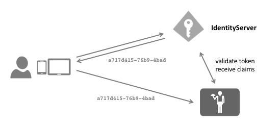

[[go back to index]](../index.md#documentation-structure)

# Reference Tokens

Access tokens can come in two flavours - self-contained or reference.

A JWT is a self-contained access token: a protected data structure with claims and an expiration. Once an API has
learned about the key material, it can validate self-contained tokens without communicating with the issuer. This
makes JWTs hard to revoke: they stay valid until they expire.

With reference tokens, the server stores the contents of the token in the [persisted grant store](persisted_grants.md#refpersistedgrants)
and only gives the client a unique identifier for it. The API receiving this reference must then ask the server, over
a back channel, to validate the token. Revoking it, or removing the grant from the store, ends it at once.



You can switch the token type of a client with the following setting:

```csharp
client.AccessTokenType = AccessTokenType.Reference;
```

The server implements OAuth 2.0 token introspection ([RFC 7662](https://tools.ietf.org/html/rfc7662)) at
`/connect/introspect`, which lets APIs dereference the tokens. The introspection endpoint requires authentication.
Since its client is an API, you configure the secret on the `ApiResource`:

```csharp
var api = new ApiResource("api1")
{
    Scopes = { "api1.read" },
    ApiSecrets = { new Secret("secret".Sha256()) }
};
```

The response only lists the scopes of the token that belong to that API resource.

MinApiLib.Oidc includes no introspection handler for APIs, and neither does ASP.NET Core: an ASP.NET Core API needs a
third-party OAuth 2.0 introspection authentication handler, or its own. APIs hosted in the server itself can use the
local API handler, which validates reference tokens in process. See [here](apis.md#refprotectingapis) for how to
protect APIs, and the [introspection endpoint](../endpoints/introspection.md) for the request and response.

[[go back to index]](../index.md#documentation-structure)
