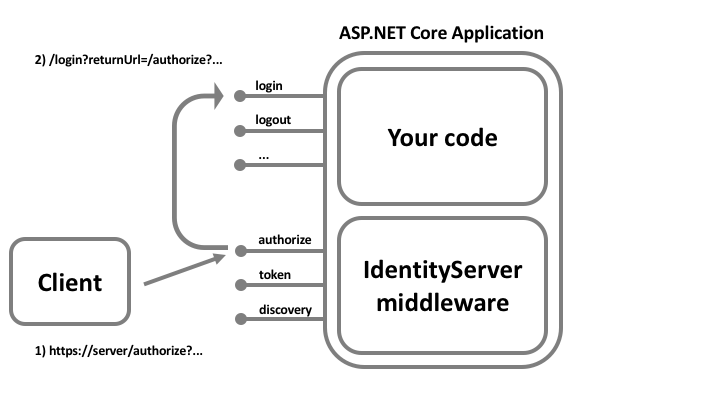

[[go back to index]](../index.md#documentation-structure)

# Sign-in

The server issues tokens for a user only after that user has signed in to the server. The server has no login page
and no user database: the host writes the login page and checks the user's credentials against its own user store.
[samples/Server](../../samples/Server) has a minimal login page with passwords and passkeys.

## Cookie authentication

The session at the server is a cookie of the ASP.NET Core
[cookie authentication](https://learn.microsoft.com/aspnet/core/security/authentication/cookie) handler.

`AddOidcServer()` registers two cookie handlers and makes the first one the default scheme:

| Scheme (`OidcServerConstants`) | Cookie | Use |
|---|---|---|
| `DefaultCookieAuthenticationScheme` | `idsrv` | The user's session at the server |
| `ExternalCookieAuthenticationScheme` | `idsrv.external` | The temporary result of an [external sign-in](signin_external_providers.md) |

`OidcServerOptions.Authentication` sets the session cookie's lifetime (`CookieLifetime`, ten hours by default),
sliding expiration (`CookieSlidingExpiration`) and `SameSite` mode (`CookieSameSiteMode`, `None` by default, which
the front-channel logout iframes and `prompt=none` requests from other sites need).

#### NOTE
The server also writes a second cookie, `idsrv.session` (`Authentication.CheckSessionCookieName`). It holds the
session id for the check session endpoint, which [browser-based clients](signout.md) use to notice that the user
signed out. It follows the session cookie and is removed when the user signs out.

### Using your own cookie handler

To configure the cookie handler yourself, register it after `AddOidcServer()` and make it the default scheme, or
name it in `Authentication.CookieAuthenticationScheme`:

```csharp
builder.Services.AddOidcServer(options => options.Authentication.CookieAuthenticationScheme = "login")
    .AddInMemoryClients(Config.Clients)
    .AddInMemoryIdentityResources(Config.IdentityResources)
    .AddInMemoryApiScopes(Config.ApiScopes);

builder.Services.AddAuthentication("login")
    .AddCookie("login", options => options.ExpireTimeSpan = TimeSpan.FromHours(1));
```

The server uses `CookieAuthenticationScheme` when it is set, and the default authenticate scheme otherwise.

## Login workflow

When a request reaches the authorize endpoint and the user has no session (or the client asked for a new sign-in
with `prompt=login`, `max_age` or, with `EnforceAcrValues`, `acr_values`), the server redirects the browser to the
login page. The page receives the authorize request as a return URL:

```http
HTTP/1.1 302 Found
Location: https://localhost:5001/account/login?returnUrl=%2Fconnect%2Fauthorize%2Fcallback%3Fclient_id%3Dweb%26...
```

Two options of `OidcServerOptions.UserInteraction` set the URL:

| Option | Default |
|---|---|
| `LoginUrl` | The `LoginPath` of the session cookie handler: `/Account/Login` in ASP.NET Core |
| `LoginReturnUrlParameter` | The `ReturnUrlParameter` of the session cookie handler: `ReturnUrl` in ASP.NET Core |

ASP.NET Core matches paths and query parameter names without regard to case, so the sample's `/account/login`
page with a `returnUrl` parameter works with the defaults. To use another page, set the option:

```csharp
builder.Services.AddOidcServer(options => options.UserInteraction.LoginUrl = "/signin");
```

`LoginUrl` can be an absolute URL on another host; the return URL is then absolute too.



#### NOTE
Beware of [open redirects](https://en.wikipedia.org/wiki/URL_redirection#Security_issues) through the return URL.
Redirect only to a return URL the server recognises (see below) or to a local path of your own.

## Login context

`IOidcServerInteractionService.GetAuthorizationContextAsync(returnUrl)` reads the authorize request from the return
URL. It returns an `AuthorizationRequest` with the client, `prompt`, `login_hint`, `acr_values`, the `idp:` hint, the
requested resources and the raw parameters, so the page can adapt: show the client's name, preselect the user name,
offer only some providers, or ask for a stronger sign-in. It returns `null` when the return URL is not a valid
authorize request, and the page should then not redirect to it. `IsValidReturnUrl(returnUrl)` gives the same answer
without the context. See the [interaction service](../reference/interactionservice.md).

```csharp
var context = await interaction.GetAuthorizationContextAsync(returnUrl);
if (context?.AcrValues.Contains("phr") == true)
{
    // the client asked for a phishing-resistant sign-in: offer only passkeys
}
```

## Signing the user in

Once the credentials are checked, the page signs the user in with the session cookie scheme and redirects to the
return URL. The server's `SignInAsync(OidcServerUser)` extension method on `HttpContext` builds the principal and
uses the right scheme:

```csharp
await http.SignInAsync(new OidcServerUser(user.Id)
{
    DisplayName = user.Name,
    AuthenticationMethods = ["pwd"],
    AdditionalClaims = { new Claim("email", user.Email) }
});

return context != null ? Results.Redirect(returnUrl) : Results.Redirect("/");
```

`OidcServerUser` (namespace `MinApiLib.Oidc.Server.Core.Models`) turns its properties into these claims:

| Property | Claim | Required | Default when missing |
|---|---|---|---|
| `SubjectId` (constructor) | `sub` | Yes | |
| `DisplayName` | `name` | No | |
| `IdentityProvider` | `idp` | No | `local` |
| `AuthenticationMethods` | `amr` (one per value) | No | `pwd` for local users, `external` otherwise |
| `AuthenticationTime` | `auth_time` | No | The time of the sign-in |
| `AdditionalClaims` | as given | No | |

The server checks that the principal has a single identity and a `sub` claim, adds the missing claims above when the
user signs in with the session scheme, and starts a new session id. Calling `HttpContext.SignInAsync` with your own
`ClaimsPrincipal` works the same way.

An `acr` claim in the session goes into the tokens as is. Set it when the login page knows the assurance level of the
sign-in (the sample sets `phr` for passkeys); with `OidcServerOptions.Authentication.EnforceAcrValues` the authorize
endpoint compares it with the client's `acr_values` (see the
[ASP.NET Core Identity quickstart](../quickstarts/6_aspnet_identity.md)).

The claims in the cookie describe the session. The claims in the tokens come from the
[profile service](../reference/profileservice.md): the default one copies the requested claims from the cookie,
and your own can read them from the user store instead.

[[go back to index]](../index.md#documentation-structure)
